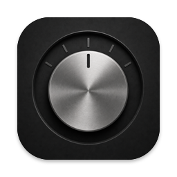
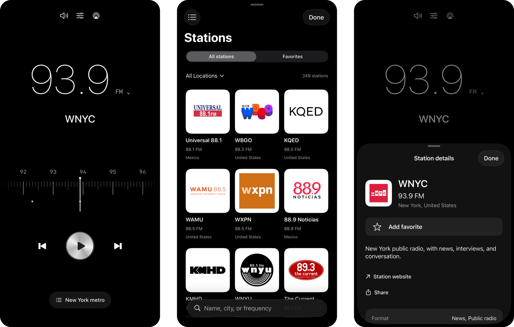

<h1>Dial</h1>

A radio tuner for iPhone and Mac. 
Turn a real dial through your city's FM and AM stations, with no ads and no account.

<strong>Version 1.1</strong> · iOS 17+ · macOS 14+

  
  
  
  

<a href="https://github.com/madebysan/dial/releases/latest">Download Dial for Mac</a>

Most radio apps hand you a database of tens of thousands of streams. Dial gives you a tuner: pick a city and turn through its real frequencies. Download it for Mac or build it for iPhone; see [Install](#install).

- 459 live stations in 13 countries as of October 2026, each stream checked before it was added.
- Live song titles when a station sends them, with one tap to search Apple Music, Spotify or Tidal.
- A sleep timer, AirPlay and Siri, plus station alarms on iPhone.

## How it works

Drag the dial or skip between a city's stations; feeds without a local frequency play in an artwork player. The Stations library searches by name, city or frequency and keeps your favorites. Playback continues in the background with Now Playing, media keys and reconnection after a network drop. The [overview](docs/overview.md) lists every feature.

## Privacy

Dial has no ads, accounts, analytics or servers of its own. Streams play directly from each broadcaster, which may include its own ads, and some station logos load from the broadcaster's site, so those servers see your IP address. "Use my location" is the one permission: it asks for approximate location only when you tap it and sends it to Apple's geocoding service to look up your country. Dial keeps the country, not the location. Favorites sync through your own iCloud account. iPhone alarms ask for alarm permission.

## Limits

No recording, song recognition or podcasts. Alarms are iPhone only and need iOS 26.1; they ring through the system and offer Play station, because they can't start internet radio from a closed app. Streams can move or go offline without notice. Dial isn't affiliated with any broadcaster.

## Install

**Mac: download it.**

1. Download the `.dmg` file from the [latest release](https://github.com/madebysan/dial/releases/latest).
2. Open it and drag Dial to Applications.
3. Open Dial. It lives in the menu bar, not the Dock: click the radio icon to show the player. The power button at the top of the player quits.

It needs macOS 14 or later and is signed and notarized by Apple. It doesn't update itself yet; download a newer release.

**iPhone: build it yourself.** You need a Mac with Xcode 26 and an Apple account; a free one works.

1. Download or clone this repo and open `Dial.xcodeproj`.
2. Select the Dial target, open Signing & Capabilities, choose your team (your Apple account) and change the bundle identifier to one of your own, such as `com.yourname.dial`. Free accounts can't use iCloud, so remove it there too.
3. Connect your iPhone (iOS 17 or later), turn on Developer Mode in Settings > Privacy & Security, choose the iPhone as the run destination and press Run.
4. The first time, trust your account in Settings > General > VPN & Device Management.

With a free Apple account the app stops opening after 7 days; press Run again to renew it. A paid Apple Developer account lasts a year. The same steps with My Mac build the Mac app.

---

[MIT](LICENSE), for the code only; station names, logos, artwork and streams belong to their broadcasters.

Made by [santiagoalonso.com](https://santiagoalonso.com)
